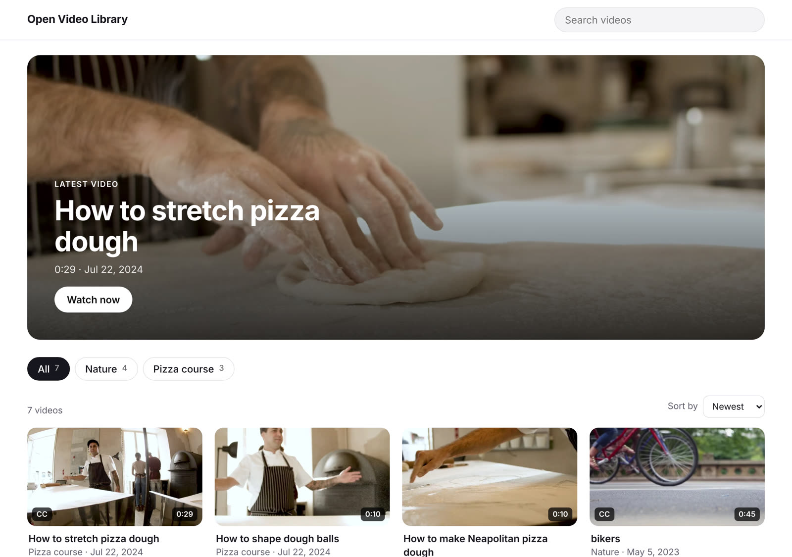

# Video library starter

A browsable video library you can put online in a few minutes. Point it at one or
more [Mave](https://www.mave.io) collections and you get a home page with
categories, folders, search and sorting, plus a watch page with the Mave player,
a transcript that follows along and an "Up next" queue.



It is plain HTML, CSS and JavaScript. There is no build step, no framework and
no server-side code, so you can host it anywhere that serves static files and
read all of it in one sitting.

## What you get

- **Home page** (`index.html`): a banner with the newest or a featured video,
  one tab per collection, folders you can browse into, search by title and five
  ways to sort. Every view has its own URL, so it can be bookmarked and shared.
- **Hover previews**: cards play a short silent preview with `<mave-clip>` when
  the video has clip renditions.
- **Watch page** (`watch.html?v={embed id}`): `<mave-player>`, a synced
  transcript with `<mave-text>`, a copy link button and the rest of the category
  as "Up next". When a video ends, the next one starts after a short countdown.
- Light and dark mode, keyboard friendly, works on phones.

## Run it

The pages use JavaScript modules, which browsers only load over HTTP. Serve the
folder with any static server:

```sh
cd starters/video-library
npx serve .
# or: python3 -m http.server 3000
```

Open the address it prints. The starter ships with two public demo collections
from the Mave docs, so you see videos right away.

## Use your own videos

1. [Create a Mave account](https://app.mave.io/signup) (or
   [self-host Mave Core](https://www.mave.io/docs/self-hosted/)), upload a few
   videos and put them in a collection.
2. Create a **read-only** API key in the dashboard settings.
3. Make a token for the collection. You find the collection ID in the dashboard
   or through the [API](https://www.mave.io/docs/get-collections/).

   ```sh
   MAVE_API_KEY=your-read-only-key node scripts/make-token.mjs <collection-id>
   ```

4. Paste the token into `config.js`, replacing the demo collections:

   ```js
   collections: [
     { label: "Talks", token: "eyJhbGciOi..." },
     { label: "Tutorials", token: "eyJhbGciOi..." },
   ],
   ```

That is all. Videos you add to the collection later show up on their own.

The token is the same one you would pass to
[`<mave-list token="...">`](https://www.mave.io/docs/list/). It can only list that
one collection and is safe to publish. The API key is not: keep it out of the
browser and out of git. A token without an expiry keeps working until you revoke
the API key. Pass a number of days as second argument to `make-token.mjs` if you
prefer tokens that expire, and renew them from a scheduled job.

`config.js` also holds the site title, the featured video, the player theme and
the switches for hover previews and autoplay. Colours, corner radius and fonts
are CSS variables at the top of `css/styles.css`.

## Put it online

Copy the folder to any static host: GitHub Pages, Netlify, Cloudflare Pages, an
S3 or Scaleway bucket, or a directory behind nginx or Caddy. There is nothing to
build and nothing to keep running.

If your videos live on a self-hosted Mave Core, set `apiEndpoint` in `config.js`
to your installation and replace the component `<script>` tags in `index.html`
and `watch.html` with the ones from your own dashboard's embed code, so the
components load videos from your installation.

## How it fits together

| File | What it does |
| --- | --- |
| `config.js` | Your settings: title, collections, theme. |
| `js/mave.js` | Loads the collections and their folders. The only file that talks to Mave. |
| `js/library.js` | The home page: tabs, folders, search, sorting, the grid. |
| `js/watch.js` | The watch page: player, transcript, "Up next", end screen. |
| `js/ui.js` | Shared pieces such as the video card and its hover preview. |
| `css/styles.css` | All styling. |
| `scripts/make-token.mjs` | Creates a collection token from your API key. |

The integration with Mave comes down to three things:

1. **One request per collection.** `js/mave.js` calls
   `GET {apiEndpoint}/collection/{token}`, the endpoint behind `<mave-list>`. It
   returns the videos (title, duration, poster, subtitles) and the folders in the
   collection. The starter fetches the data itself instead of rendering
   `<mave-list>`, because search, sorting and shareable folder URLs need the
   data in hand.
2. **Posters from the image API.** Card images are
   `https://image.mave.io/{embed id}.webp?width=640`, resized on the fly. See
   [Images](https://www.mave.io/docs/images/).
3. **Components for everything that plays.** `<mave-clip>` for previews,
   `<mave-player>` for watching and `<mave-text>` for the transcript. Each one
   only needs an embed ID. Picking another video on the watch page changes the
   `embed` attribute and the player does the rest.

## Good to know

- **Public videos only.** A collection token lists videos but does not unlock
  private playback. For a members-only library you need a small server that
  signs playback tokens per viewer. See
  [Secure playback](https://www.mave.io/docs/secure-video-playback/).
- **Folders.** A token for one collection can open the folders directly inside
  it. Deeper folders are skipped. A token for the whole space (the 5-character
  space ID as `sub`) can open every folder.
- **Search looks at titles.** Everything is loaded up front and filtered in the
  browser, which is instant for libraries up to a few hundred videos. For larger
  ones, or to search inside transcripts, move the search to a server.
- **Transcripts** appear for videos that have one. Hover previews appear for
  videos with clip renditions. Videos without them simply skip that feature.

## Ideas to extend it

- A page per speaker, topic or series, using one collection each.
- Titles and descriptions per video from your own CMS, keyed by embed ID.
- A "Continue watching" row that remembers progress in `localStorage`.
- An upload page for contributors with
  [`<mave-upload>`](https://www.mave.io/docs/upload/).
